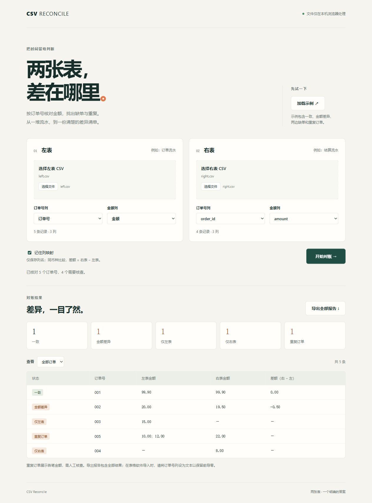

# CSV Reconcile

**Two CSVs. Exact amounts. Clear differences.**

两张 CSV 按订单号自动对账，找出金额差异、缺单与重复订单。适合核对订单与结算流水、业务导出表和账目清单。

文件在本机浏览器内读取和计算。支持本机列映射保存、筛选明细和 CSV 报告导出，附 CLI。零第三方运行依赖。



## 快速开始

需要 [Node.js](https://nodejs.org/) **22 或更高版本**。

```sh
git clone https://github.com/tom090tom/csv-reconcile.git
cd csv-reconcile
npm start
```

打开 <http://127.0.0.1:4173>，点击“加载示例”，再点击“开始对账”。不需要 `npm install`。

实际使用：选择两份 UTF-8 CSV → 确认两边订单号与金额列 → 开始对账 → 筛选或导出报告。勾选“记住列映射”后，相同列名会在后续导入时复用；取消勾选会清除已保存映射。

端口占用时：`npm start -- --port 4174`。

## 示例结果

仓库的 `examples/` 全部为合成数据。

| 订单号 | 左表金额 | 右表金额 | 结果 |
| --- | --- | --- | --- |
| 001 | 99.90 | 99.90 | 一致 |
| 002 | 20.00 | 19.50 | 金额差异，右减左为 -0.50 |
| 003 | 15.00 | — | 仅左表 |
| 004 | — | 8.00 | 仅右表 |
| 005 | 10.00; 12.00 | 22.00 | 重复订单，需人工核查 |

汇总按不同订单号计数，示例共 5 个，每种结果各 1 个。

## 对账规则与边界

- **订单号：** 作为文本，去掉首尾空白后精确匹配，区分大小写，保留前导零。任一侧重复都单独标记，不求和、不挑选其中一笔。
- **金额：** 同币种比较，整数分与 BigInt 精确计算。接受 `1234`、`-12.30`、`1,234.56`；最多两位小数、18 位整数。CSV 内带逗号的金额需写成 `"1,234.56"`。
- **格式：** UTF-8、逗号分隔、必需表头。支持 BOM、CRLF、带引号的逗号、双引号转义和多行字段；表头不能重复或为空，两种映射必须选择不同列。
- **规模：** 页面与 CLI 每份文件最多 5 MB；解析器每份最多 50,000 条数据记录。页面显示当前筛选的前 200 条，导出始终包含全部结果。
- **错误：** 空订单号、无效金额、字段数量不一致或畸形引号会阻止本次对账。记录号包括表头、不计算空白行；引号内换行仍属于同一记录。
- **导出：** UTF-8 BOM CSV，公式起始字符会前置单引号，因此负数也可能显示为文本。Excel 等软件导入时应把订单号列设为文本，CSV 格式本身无法保证表格软件保留前导零。
- **首版范围：** 不读取 `.xlsx`、GBK 或分号分隔文件；不做币种换算、拆单聚合或容差匹配。请先导出为 UTF-8 CSV。结果用于核查，异常的业务原因由使用者确认。

## CLI 与共享模块

```sh
npm run demo
node bin/reconcile.js examples/left.csv examples/right.csv --left-key 订单号 --left-amount 金额 --right-key order_id --right-amount amount --output report.csv
```

默认报告写到 stdout，汇总写到 stderr。`--output` 仅创建新文件，已有同名文件时退出并保留原内容。退出码：成功 `0`，输入或执行错误 `1`。项目中的真实输入与导出可放在已忽略的 `data/`、`reports/`。

```js
import { parseCSV } from './src/csv.js';
import { reconcile } from './src/reconcile.js';

const result = reconcile(
  parseCSV('id,amount\n001,10.10'),
  parseCSV('order,value\n001,10.12'),
  { left: { key: 'id', amount: 'amount' }, right: { key: 'order', amount: 'value' } }
);
console.log(result.records[0].difference); // '0.02'：右减左
```

## 开发与验证

```sh
npm test
npm run check
```

`src/` 是共享 CSV、金额与报告模块；`web/` 是界面；`bin/` 是 CLI 和回环地址静态服务；`tests/` 验证边界与实际运行入口。

CI 尚未启用：当前推送凭据没有 GitHub `workflow` 权限。已提供 [CI 模板](docs/ci-template.yml)，具备工作流写入权限时可放入 `.github/workflows/ci.yml`，验证 Linux/Windows 与 Node.js 22/24。本地已验证 Windows / Node.js 24.20.0 的 56 项测试。

技术取舍：金额使用整数分避免浮点误差；重复订单保留原笔数避免误报一致；静态服务只提供固定资源且拒绝上传，业务数据始终留在浏览器内。列映射仅含列名，保存在当前浏览器本机存储。限制文件规模以控制内存占用，后续扩展依据实际反馈。

## 安全、免责与开源协作

本工具用于辅助核查，不替代会计、审计或业务审批。重要决策前请核对原始数据与结果并保留备份。软件按 MIT 许可证现状提供；法律适用范围和使用责任见 [免责说明](DISCLAIMER.md)，安全边界及漏洞私报见 [SECURITY.md](SECURITY.md)。

版本 `0.1.1`，MIT 开源；GitHub 公开不等于把服务部署到公网。`package.json` 的 `private: true` 只阻止误发 npm。协作遵循 [贡献与 Git 规范](CONTRIBUTING.md)：SemVer、约定式提交、短期分支、PR 评审及 [CHANGELOG](CHANGELOG.md)。Issue 与 PR 模板帮助保留复现和验证证据。
